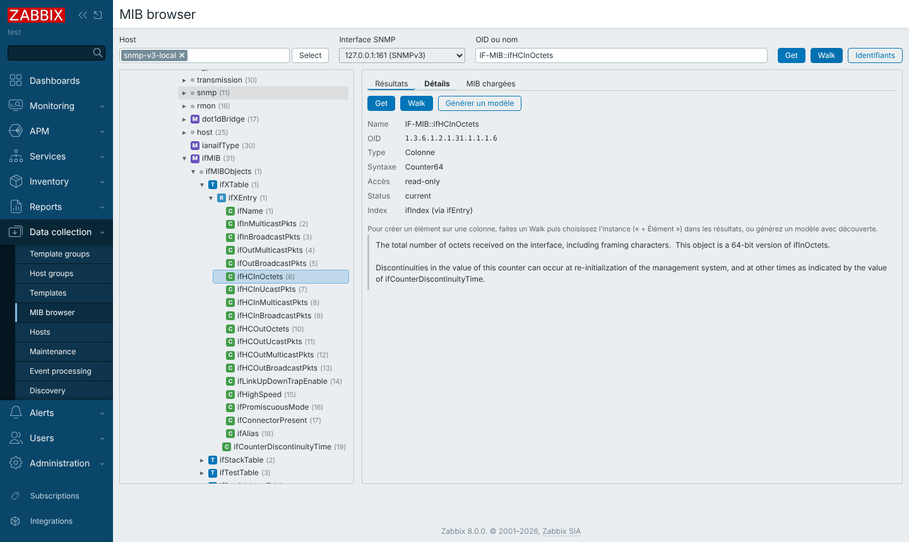
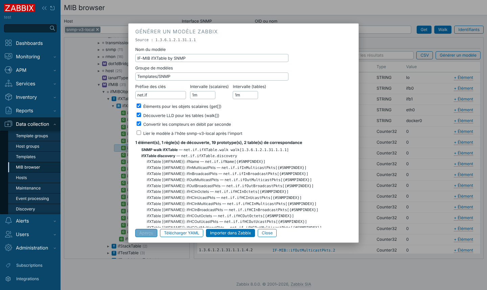
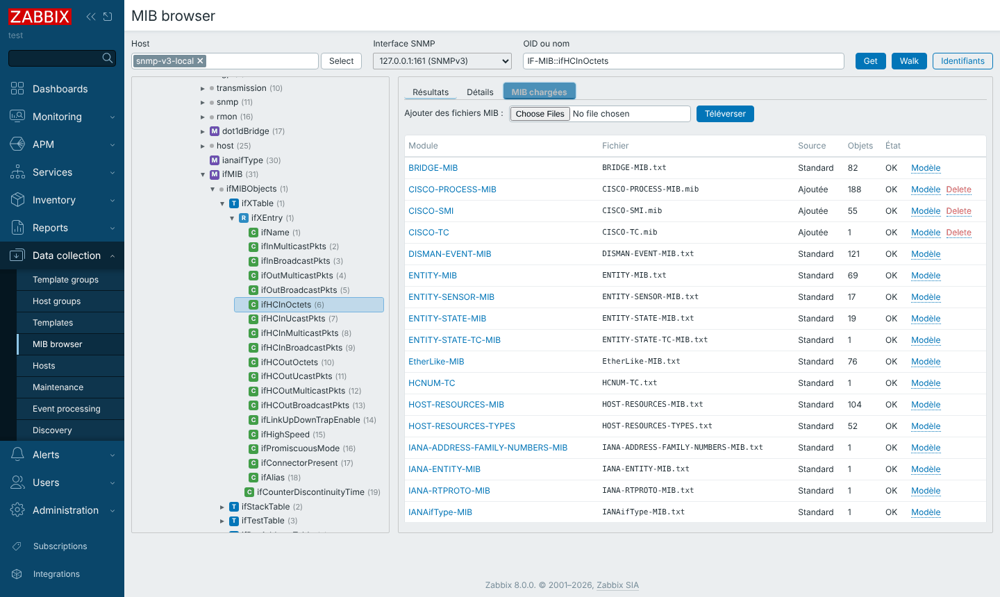
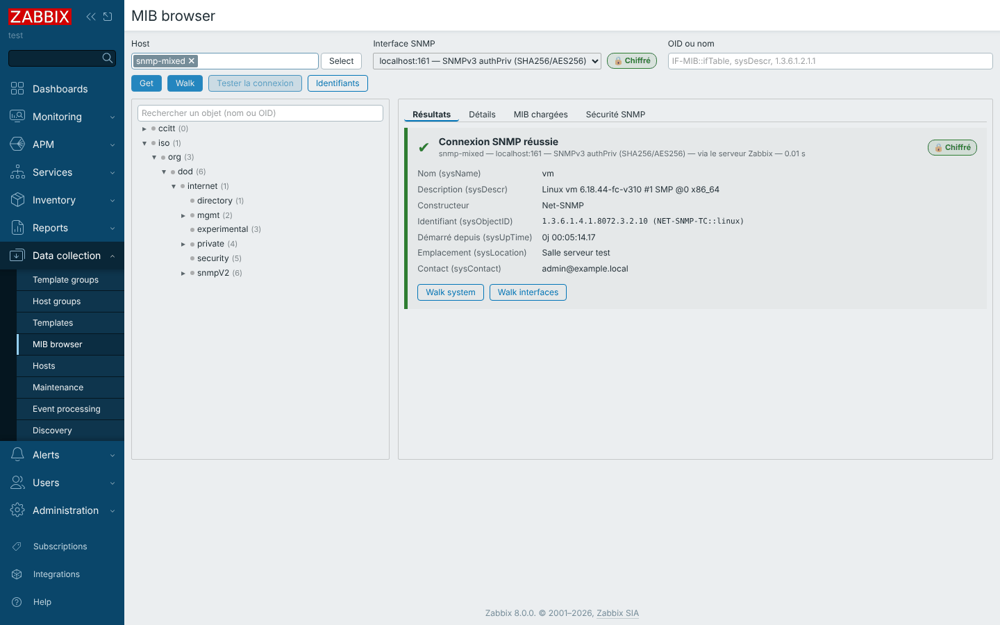
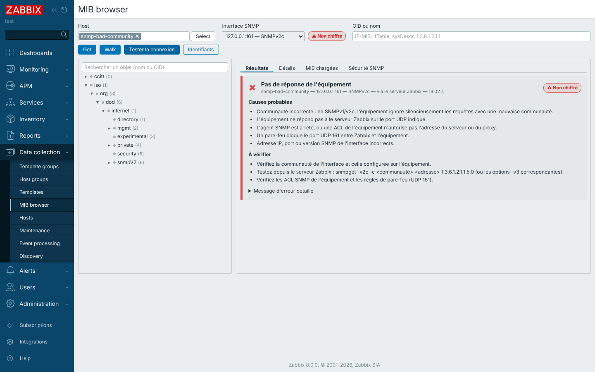
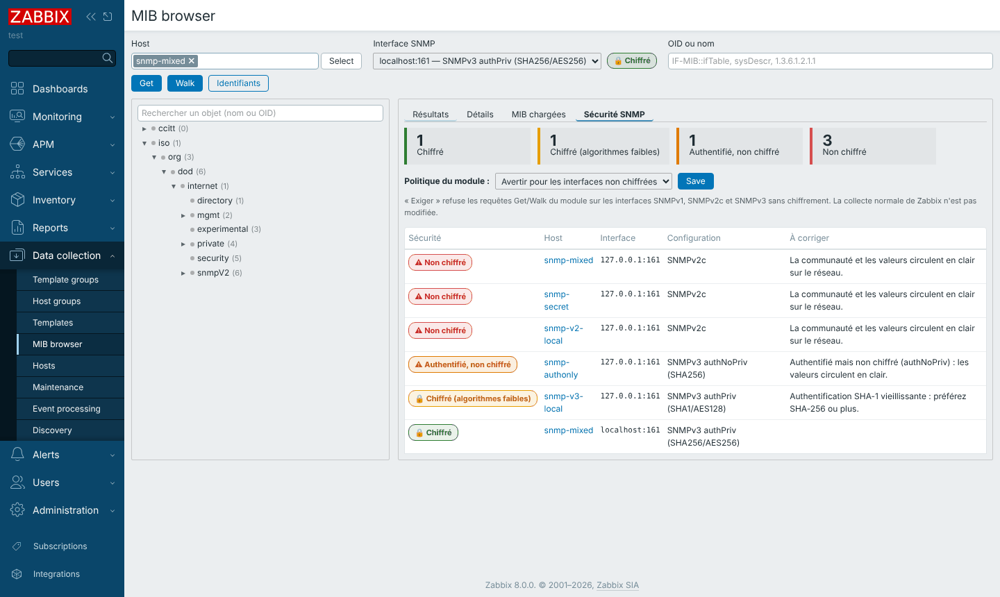
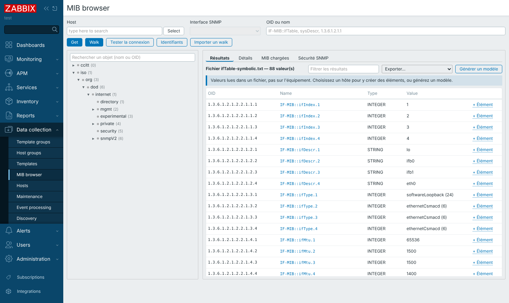
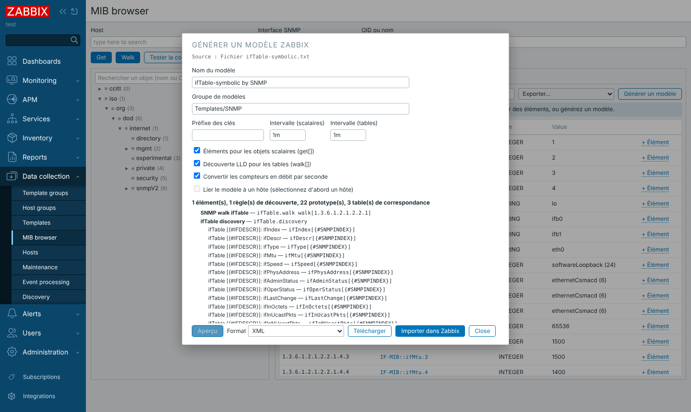
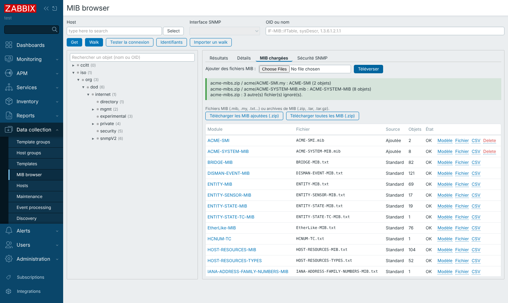
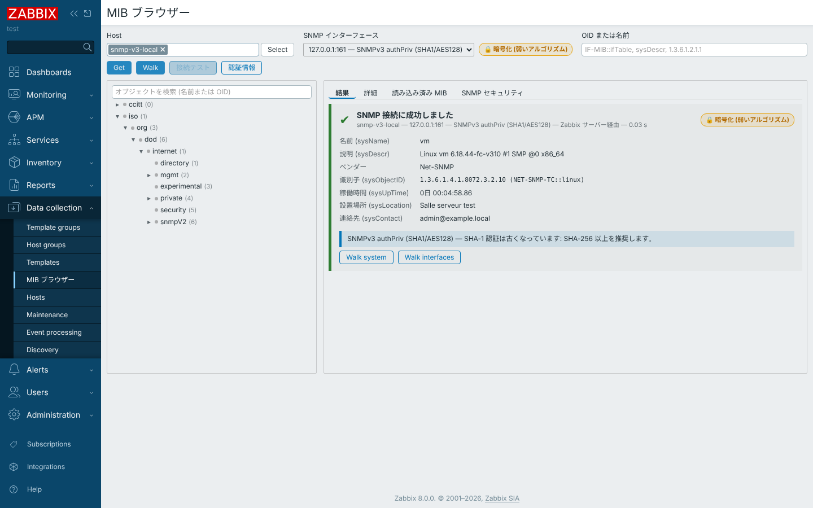

# Zabbix MIB Browser

Navigateur de MIB SNMP intégré à l'interface web de **Zabbix 8.0**.

Le module ajoute un écran **Data collection → MIB browser** qui permet :

- de **charger des fichiers MIB** (standards fournis, ou MIB constructeurs ajoutées par un administrateur) et de parcourir l'arbre des objets avec leurs noms, types, descriptions et valeurs énumérées ;
- d'**interroger un hôte** en SNMP (`get` et `walk`) avec les identifiants déjà configurés sur son interface SNMP (v1, v2c, v3), **en passant par le serveur Zabbix ou par le proxy de l'hôte** ;
- de **créer un élément en un clic** à partir d'une valeur trouvée, sur l'hôte ou sur un modèle ;
- de **générer un modèle Zabbix 8.0 complet** à partir d'une MIB ou d'une partie de l'arbre, puis de le télécharger en YAML, XML ou JSON ou de l'importer directement (et de le lier à l'hôte) ;
- d'**importer et d'exporter** : résultats en CSV, Excel, JSON, XML ou texte snmpwalk, fichiers de walk ouverts **sans accès à l'équipement**, MIB en lot depuis une archive, export des MIB et des branches de l'arbre.


## Fonctionnalités

| | |
|---|---|
| **Arbre MIB** | Chargement progressif, recherche par nom ou par OID, badges par type d'objet (table, ligne, colonne, scalaire, notification…). |
| **Détails d'un objet** | Syntaxe et type de base (conventions textuelles résolues), accès, statut, unités, index, valeurs énumérées, description. |
| **Tester la connexion** | Un clic lit le groupe *system* de l'équipement (nom, description, constructeur, modèle, uptime, emplacement) avec le temps de réponse et le niveau de chiffrement. En cas d'échec, un **diagnostic** explique la cause probable et quoi vérifier : communauté, utilisateur SNMPv3, phrase d'authentification ou de chiffrement, niveau de sécurité, DNS, réseau/pare-feu, proxy, hôte pas encore chargé par le serveur. |
| **Get / Walk** | Résultats traduits en noms MIB (`IF-MIB::ifInOctets.3`), valeurs mises en forme (énumérations, adresses MAC, durées, dates), filtre, export **CSV, Excel (.xlsx), JSON, XML ou texte snmpwalk**. |
| **Import d'un walk** | Ouvrir un fichier de walk (sortie `snmpwalk` numérique ou symbolique, exports du module, `.gz` ou `.zip`) pour parcourir un équipement **hors ligne**, créer des éléments ou **générer un modèle** limité aux objets présents dans le fichier. |
| **Identifiants** | Ceux de l'interface SNMP de l'hôte, macros utilisateur résolues. Si l'interface utilise une **macro secrète**, le module demande la valeur pour la requête (elle n'est jamais enregistrée). |
| **Création d'élément** | Élément SNMP `get[OID]` avec type d'information, unités, prétraitement (« Change per second » pour les compteurs, multiplicateur pour les TimeTicks) et **table de correspondance** créée depuis l'énumération MIB. |
| **Génération de modèle** | Même approche que les modèles officiels Zabbix 8.0 : `get[]` pour les scalaires ; pour chaque table un élément maître `walk[]`, une **découverte LLD** dépendante (« SNMP walk to JSON ») et des **prototypes** dépendants (« SNMP walk value »). UUID stables : réimporter met à jour le même modèle. Téléchargement en **YAML, XML ou JSON** (les trois formats d'import de Zabbix). |
| **Sécurité SNMP** | L'interface **SNMPv3 chiffrée (authPriv)** est choisie par défaut ; un badge indique le niveau de sécurité de l'interface utilisée ; les requêtes en clair (SNMPv1/v2c, SNMPv3 sans chiffrement) sont signalées ; un onglet dresse l'état de tous les hôtes SNMP ; une politique peut **exiger le chiffrement**. |
| **Langues** | L'interface du module suit la **langue du profil Zabbix** de l'utilisateur : les 25 langues proposées par Zabbix 8.0 sont prises en charge. |
| **Gestion des MIB** | Ajout de fichiers ou d'**archives (.zip, .tar, .tar.gz)** par un Super administrateur, détection des **dépendances manquantes**, suppression des MIB ajoutées, téléchargement d'une MIB, des MIB ajoutées ou de toutes les MIB (.zip), export des objets d'un module ou d'une branche (CSV, Excel, JSON). |

| Détails d'un objet | Création d'un élément |
|---|---|
|  |  |

| Génération de modèle | MIB chargées |
|---|---|
|  |  |

| Test de connexion réussi | Test en échec avec diagnostic |
|---|---|
|  |  |



| Walk importé depuis un fichier | Modèle en YAML, XML ou JSON |
|---|---|
|  |  |





## Prérequis

- Zabbix **8.0** (testé avec 8.0.0), interface web en PHP **8.2 ou plus**.
- Aucune extension PHP SNMP n'est nécessaire : les requêtes sont exécutées par le **serveur Zabbix** (ou le proxy), comme le bouton « Test » du formulaire d'élément. L'interface web n'a donc pas besoin d'accès réseau aux équipements.
- Utilisateur de type **Admin** ou **Super admin** pour utiliser le module. L'ajout et la suppression de MIB sont réservés aux **Super admin**.

## Installation

1. Cloner le dépôt dans le dossier `modules/` de l'interface web de Zabbix. Le chemin dépend de l'installation : par exemple `/usr/share/zabbix/ui/modules/` (paquets officiels récents) ou `/usr/share/zabbix/modules/`.

   ```bash
   cd /usr/share/zabbix/ui/modules/
   git clone https://github.com/GENIUS-DEVCO/zabbix-mib-browser.git mibbrowser
   ```

2. Donner au serveur web le droit d'écrire dans le dossier de données (MIB ajoutées et cache) :

   ```bash
   chown -R www-data:www-data mibbrowser/data      # Debian/Ubuntu (Apache ou nginx)
   # chown -R apache:apache mibbrowser/data        # RHEL/Alma/Rocky avec Apache
   # chown -R nginx:nginx mibbrowser/data          # RHEL/Alma/Rocky avec nginx
   ```

3. Dans Zabbix : **Administration → General → Modules → Scan directory**, puis activer **MIB Browser**.

4. L'écran est disponible dans **Data collection → MIB browser**.

### Mise à jour

```bash
cd /usr/share/zabbix/ui/modules/mibbrowser && git pull
```

Les MIB ajoutées et le cache se trouvent dans `data/`, qui est ignoré par Git : une mise à jour ne les efface pas.

### Protéger le dossier de données

Le dossier `data/` ne contient que des fichiers MIB et un cache, mais il n'a pas besoin d'être servi par le serveur web. Un fichier `.htaccess` le bloque avec Apache. Avec nginx, ajouter dans le bloc `server` de Zabbix :

```nginx
location ~ ^/modules/mibbrowser/data/ {
    deny all;
}
```

## Utilisation

1. Choisir un **hôte** ayant une interface SNMP, puis l'interface. **Tester la connexion** vérifie en un clic que l'équipement répond et explique la cause en cas d'échec.
2. Saisir un OID ou un nom (`sysDescr`, `IF-MIB::ifTable`, `1.3.6.1.2.1.25`), ou sélectionner un objet dans l'arbre.
3. Cliquer sur **Get** (une valeur ; `.0` est ajouté automatiquement pour un scalaire) ou **Walk** (tout le sous-arbre).
4. Dans les résultats, **+ Élément** crée un élément pour l'instance choisie ; **Générer un modèle** crée un modèle pour le sous-arbre interrogé.
5. Onglet **MIB chargées** : ajouter des fichiers MIB constructeurs. Si une MIB dépend d'autres modules (par exemple `CISCO-SMI`, `CISCO-TC`), la colonne « État » les indique : il suffit de les ajouter aussi, la résolution se fait automatiquement.

## Import et export

### Résultats (Get / Walk)

Le menu **Exporter…** des résultats propose :

| Format | Contenu | Réimportable |
|---|---|---|
| CSV | OID, nom, type, valeur affichée, valeur brute, type SNMP (séparateur `;`, UTF-8 avec BOM pour Excel) | oui |
| Excel (.xlsx) | Feuille « SNMP » avec filtre et en-tête figé (les compteurs restent des nombres) et feuille « Info » (hôte, requête, date) | non |
| JSON | Hôte, requête, date et valeurs | oui |
| XML | Même contenu que le JSON | oui |
| Texte snmpwalk | Format `snmpwalk -On` (`.1.3.6… = STRING: "…"`), identique aux valeurs `walk[]` de Zabbix | oui |

### Import d'un walk (hors ligne)

Le bouton **Importer un walk** ouvre un fichier et affiche ses valeurs comme un walk, sans interroger d'équipement : pratique pour un équipement inaccessible depuis Zabbix, un walk fourni par un client ou un constructeur, ou pour préparer un modèle avant la mise en service.

Formats reconnus automatiquement :

- sortie de `snmpwalk` (Net-SNMP) : numérique (`-On`), `iso.3.6…` (sans MIB), symbolique (`IF-MIB::ifDescr.2`, `-OX` avec `[index]`), index texte (`vacmGroupName.3."admin"`) ou énumérés (`.authPriv`), valeurs `Timeticks: (123) 0:00:01.23`, `INTEGER: up(1)`, unités, `Hex-STRING` sur plusieurs lignes ;
- exports CSV, JSON, XML et snmpwalk du module ;
- fichiers compressés `.gz` ou `.zip` (le fichier le plus gros de l'archive).

Les noms symboliques sont résolus avec les MIB chargées : chargez d'abord les MIB du constructeur. Les lignes non reconnues sont comptées et montrées en exemple. Depuis un walk importé, **Générer un modèle** ne garde que les objets et les colonnes présents dans le fichier. Le fichier n'est pas conservé sur le serveur.

### Modèles

Le modèle généré se télécharge en **YAML, XML ou JSON** ; les trois fichiers s'importent dans Zabbix (*Data collection → Templates → Import*) et donnent exactement le même modèle.

### MIB

- **Ajout en lot** : un Super admin peut envoyer une archive `.zip`, `.tar`, `.tar.gz` ou `.tgz` de MIB (par exemple le paquet de MIB d'un constructeur). Les fichiers qui ne contiennent pas de module MIB (README, PDF, métadonnées macOS…) sont ignorés. Les archives sont lues en PHP, sans extension `zip`, avec des limites de taille contre les archives piégées.
- **Téléchargement** : une MIB (bouton *Fichier*), les MIB ajoutées ou toutes les MIB en `.zip`.
- **Export des objets** d'un module (bouton *CSV*) ou d'une branche de l'arbre (menu *Exporter la branche…* des détails) en CSV, Excel ou JSON : OID, module, nom, type, syntaxe, accès, statut, unités, index, valeurs énumérées, description.

## Sécurité SNMP et chiffrement

SNMPv1 et SNMPv2c envoient la communauté et toutes les valeurs **en clair** sur le réseau. Seul **SNMPv3 avec le niveau `authPriv`** chiffre les échanges. Le module en tient compte :

| Niveau | Configuration | Affichage |
|---|---|---|
| 🔒 **Chiffré** | SNMPv3 authPriv avec SHA-224/256/384/512 et AES | badge vert |
| 🔒 **Chiffré, algorithmes faibles** | SNMPv3 authPriv avec MD5, SHA-1 ou DES | badge orange, algorithme à remplacer indiqué |
| ⚠ **Authentifié, non chiffré** | SNMPv3 authNoPriv | badge orange |
| ⚠ **Non chiffré** | SNMPv1, SNMPv2c, SNMPv3 noAuthNoPriv | badge rouge |

- Quand un hôte a plusieurs interfaces SNMP, **la plus sûre est sélectionnée par défaut**.
- Les résultats d'une requête non chiffrée affichent un avertissement.
- L'onglet **Sécurité SNMP** liste toutes les interfaces SNMP visibles par l'utilisateur, des moins sûres aux plus sûres, avec ce qu'il faut corriger et un lien vers l'hôte.
- **Politique** (Super admin, dans l'onglet Sécurité SNMP) :
  - *Avertir* (par défaut) : toutes les requêtes sont possibles, les accès en clair sont signalés ;
  - *Exiger SNMPv3 chiffré* : le module refuse les Get/Walk sur les interfaces non chiffrées. La collecte normale de Zabbix n'est pas modifiée.
- Les identifiants saisis dans « Identifiants » transitent entre le navigateur et Zabbix : le module avertit si la page n'est pas servie en **HTTPS**.

Exemple de configuration SNMPv3 chiffrée sur un équipement Linux (Net-SNMP), à reporter ensuite sur l'interface SNMP de l'hôte dans Zabbix (version SNMPv3, niveau `authPriv`, SHA256, AES256) :

```
# /etc/snmp/snmpd.conf
createUser zabbix SHA-256 "<phrase-auth>" AES256 "<phrase-chiffrement>"
rouser zabbix priv
```

Stockez de préférence les phrases secrètes dans des **macros secrètes** (`{$SNMPV3_AUTHPASS}`, `{$SNMPV3_PRIVPASS}`) : le module ne peut pas les lire et vous demandera de les saisir pour une requête ponctuelle, sans les enregistrer.

## Configuration

Les options se trouvent dans `manifest.json`, section `config` :

| Option | Défaut | Rôle |
|---|---|---|
| `data_dir` | `""` (= `<module>/data`) | Dossier des MIB ajoutées et du cache, accessible en écriture par le serveur web. |
| `max_upload_size` | `5242880` | Taille maximale d'un fichier MIB (octets). |
| `max_results` | `5000` | Nombre maximal de lignes affichées pour un walk. |
| `max_walk_size` | `20971520` | Taille maximale d'un fichier de walk importé (octets). |
| `max_archive_size` | `52428800` | Taille maximale d'une archive de MIB (octets). |
| `snmp_security` | `warn` | `warn` ou `require_encryption`. Se règle depuis l'onglet **Sécurité SNMP**. |

Les limites d'envoi de PHP s'appliquent aussi (`upload_max_filesize`, `post_max_size`).

Zabbix copie ces options dans sa base de données lors de l'activation du module : modifier `manifest.json` ensuite n'a pas d'effet. La politique de sécurité se change dans l'onglet Sécurité SNMP ; pour les autres options, utilisez l'API (`module.update`) ou réactivez le module après l'avoir supprimé de la liste des modules.

Le délai d'une requête SNMP est celui défini dans Zabbix pour les agents SNMP (réglage global ou du proxy). Pour les très grands sous-arbres, faites un walk sur une partie plus petite : le serveur Zabbix tronque les réponses trop volumineuses et le module le signale.

## Langues

Le module s'affiche dans la langue choisie dans le profil Zabbix de l'utilisateur (*Profil utilisateur → Langue*), ou dans la langue par défaut du système si le profil est sur « Default ». Toutes les langues proposées par Zabbix 8.0 sont prises en charge :

| Code | Langue | Code | Langue | Code | Langue |
|---|---|---|---|---|---|
| `en_GB`, `en_US` | Anglais | `he_IL` | Hébreu | `pl_PL` | Polonais |
| `ca_ES` | Catalan | `it_IT` | Italien | `pt_BR` | Portugais (Brésil) |
| `zh_CN` | Chinois simplifié | `ja_JP` | Japonais | `pt_PT` | Portugais (Portugal) |
| `cs_CZ` | Tchèque | `ka_GE` | Géorgien | `ru_RU` | Russe |
| `da_DK` | Danois | `ko_KR` | Coréen | `sk_SK` | Slovaque |
| `de_DE` | Allemand | `lv_LV` | Letton | `es_ES` | Espagnol |
| `fr_FR` | Français | `nb_NO` | Norvégien (bokmål) | `tr_TR` | Turc |
| `uk_UA` | Ukrainien | `uz_UZ` | Ouzbek | `vi_VN` | Vietnamien |

Les autres langues de Zabbix (non affichées par défaut dans son interface) utilisent l'anglais.

Les textes sources sont en anglais dans le code (`I18n::t()`, `I18n::s()`), les traductions dans `lang/<langue>.php` sous forme de tableau `'texte anglais' => 'traduction'` (`lang/pt_BR.php` est prioritaire sur `lang/pt.php`). Un texte absent ou vide reste en anglais. Les libellés que Zabbix traduit déjà (Hôte, Nom, Enregistrer…) utilisent ses propres traductions.

**Corriger ou améliorer une traduction** : modifiez le fichier `lang/` correspondant, gardez les paramètres `%1$s`, `%2$s`… et les termes techniques (`authPriv`, `walk[]`, `{$SNMP_COMMUNITY}`…), puis lancez `php tests/run.php` : un test vérifie que chaque langue contient tous les textes avec les mêmes paramètres. Les traductions ont été produites avec l'aide d'une IA ; les corrections par des locuteurs natifs sont bienvenues.

## Fonctionnement

```
Navigateur ──► Module (PHP, interface Zabbix) ──► Serveur Zabbix ──► (proxy) ──► Équipement SNMP
                 │  item.test : walk[OID] / get[OID]
                 └─ Analyse des MIB (PHP, sans dépendance) et cache JSON
```

- `lib/MibParser.php` : analyse SMIv1/SMIv2 tolérante (modules, imports, OBJECT-TYPE, TEXTUAL-CONVENTION, TRAP-TYPE…).
- `lib/MibRepository.php` : résolution des OID entre modules, arbre, recherche, traduction des OID numériques, cache.
- `lib/ZabbixSnmp.php` : requêtes via le serveur Zabbix, résolution des macros des identifiants, choix du proxy.
- `lib/SnmpSecurity.php` : niveau de sécurité des interfaces (chiffrement SNMPv3, algorithmes) et politique.
- `lib/ItemMapper.php`, `lib/TemplateBuilder.php`, `lib/YamlWriter.php` : correspondance MIB → éléments et génération des modèles.
- `lib/WalkImporter.php` : lecture des fichiers de walk (Net-SNMP et exports du module).
- `lib/ResultExporter.php`, `lib/TreeExporter.php`, `lib/ZabbixXmlWriter.php` : exports des résultats, des branches et des modèles.
- `lib/ZipWriter.php`, `lib/ArchiveReader.php`, `lib/XlsxWriter.php` : ZIP, TAR/GZIP et Excel en PHP, sans extension supplémentaire.
- `lib/I18n.php` et `lang/` : traductions de l'interface du module.

## MIB fournies

Le dossier `mibs/` contient 43 MIB standards (IETF et Net-SNMP) : SNMPv2, IF-MIB, HOST-RESOURCES-MIB, IP/TCP/UDP, BRIDGE, RMON, ENTITY-MIB et ENTITY-SENSOR-MIB, UCD-SNMP-MIB, etc. Voir [mibs/README.md](mibs/README.md).

## Limites

- Lecture seule : pas de `set`.
- Pas de réception de traps (Zabbix les gère avec `snmptrapd` et les éléments `snmptrap[]`).
- Si deux fichiers définissent le même module MIB, le premier chargé est utilisé (les MIB standards sont prioritaires) ; le doublon est signalé.

## Tests

```bash
php tests/run.php
```

Les tests couvrent l'analyse des MIB, la résolution des OID, la lecture des réponses `walk[]` (exemples réels du serveur Zabbix 8.0), la correspondance MIB → élément, la génération de modèles, l'import de walks réels (snmpwalk numérique, symbolique, `-OX`, `iso.`, index texte et énumérés), les exports et leur réimport, les archives, les fichiers Excel, les modèles XML et la complétude des traductions. Ils tournent automatiquement sur GitHub Actions (PHP 8.2, 8.3 et 8.4).

Le module a aussi été testé de bout en bout sur un Zabbix 8.0.0 compilé depuis les sources, avec un agent Net-SNMP en SNMPv2c et SNMPv3 (authPriv) : walk, création d'éléments, import de modèles et découverte LLD avec collecte des valeurs.

## Licence

[GNU AGPL v3](LICENSE), comme Zabbix. Les MIB fournies gardent leurs licences d'origine (voir `mibs/README.md`).
