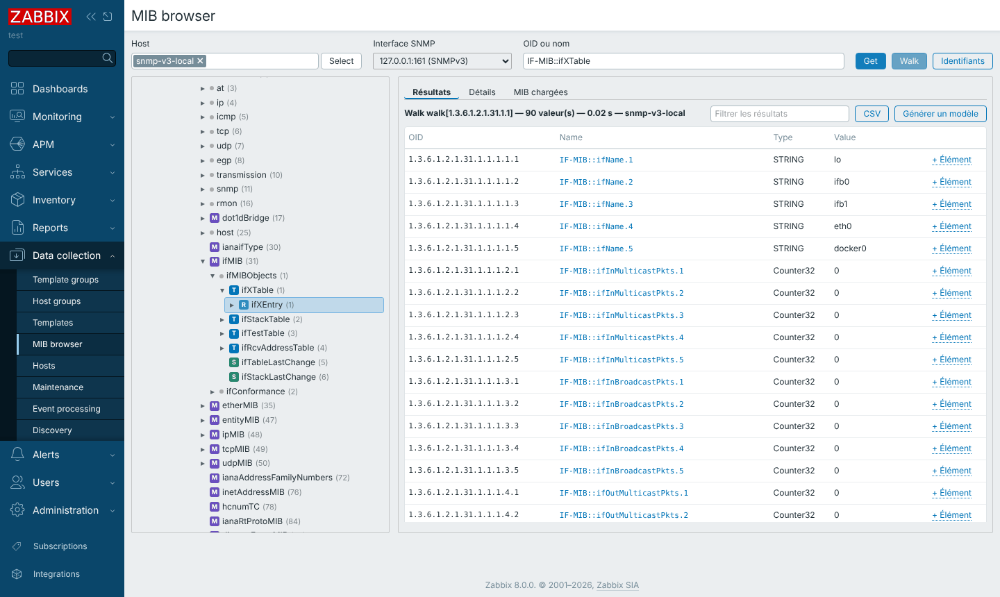
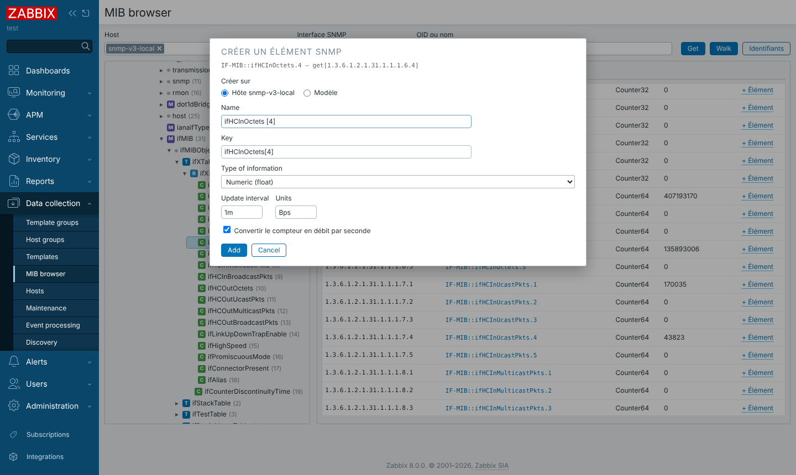

# Zabbix MIB Browser

Navigateur de MIB SNMP intégré à l'interface web de **Zabbix 8.0**.

Le module ajoute un écran **Data collection → MIB browser** qui permet :

- de **charger des fichiers MIB** (standards fournis, ou MIB constructeurs ajoutées par un administrateur) et de parcourir l'arbre des objets avec leurs noms, types, descriptions et valeurs énumérées ;
- d'**interroger un hôte** en SNMP (`get` et `walk`) avec les identifiants déjà configurés sur son interface SNMP (v1, v2c, v3), **en passant par le serveur Zabbix ou par le proxy de l'hôte** ;
- de **créer un élément en un clic** à partir d'une valeur trouvée, sur l'hôte ou sur un modèle ;
- de **générer un modèle Zabbix 8.0 complet** à partir d'une MIB ou d'une partie de l'arbre, puis de le télécharger en YAML ou de l'importer directement (et de le lier à l'hôte).



## Fonctionnalités

| | |
|---|---|
| **Arbre MIB** | Chargement progressif, recherche par nom ou par OID, badges par type d'objet (table, ligne, colonne, scalaire, notification…). |
| **Détails d'un objet** | Syntaxe et type de base (conventions textuelles résolues), accès, statut, unités, index, valeurs énumérées, description. |
| **Get / Walk** | Résultats traduits en noms MIB (`IF-MIB::ifInOctets.3`), valeurs mises en forme (énumérations, adresses MAC, durées, dates), filtre, export CSV. |
| **Identifiants** | Ceux de l'interface SNMP de l'hôte, macros utilisateur résolues. Si l'interface utilise une **macro secrète**, le module demande la valeur pour la requête (elle n'est jamais enregistrée). |
| **Création d'élément** | Élément SNMP `get[OID]` avec type d'information, unités, prétraitement (« Change per second » pour les compteurs, multiplicateur pour les TimeTicks) et **table de correspondance** créée depuis l'énumération MIB. |
| **Génération de modèle** | Même approche que les modèles officiels Zabbix 8.0 : `get[]` pour les scalaires ; pour chaque table un élément maître `walk[]`, une **découverte LLD** dépendante (« SNMP walk to JSON ») et des **prototypes** dépendants (« SNMP walk value »). UUID stables : réimporter met à jour le même modèle. |
| **Gestion des MIB** | Ajout de fichiers par un Super administrateur, détection des **dépendances manquantes**, suppression des MIB ajoutées. |

| Détails d'un objet | Création d'un élément |
|---|---|
|  |  |

| Génération de modèle | MIB chargées |
|---|---|
|  |  |

## Prérequis

- Zabbix **8.0** (testé avec 8.0.0), interface web en PHP **8.2 ou plus**.
- Aucune extension PHP SNMP n'est nécessaire : les requêtes sont exécutées par le **serveur Zabbix** (ou le proxy), comme le bouton « Test » du formulaire d'élément. L'interface web n'a donc pas besoin d'accès réseau aux équipements.
- Utilisateur de type **Admin** ou **Super admin** pour utiliser le module. L'ajout et la suppression de MIB sont réservés aux **Super admin**.

## Installation

1. Cloner le dépôt dans le dossier `modules/` de l'interface web de Zabbix. Le chemin dépend de l'installation : par exemple `/usr/share/zabbix/ui/modules/` (paquets officiels récents) ou `/usr/share/zabbix/modules/`.

   ```bash
   cd /usr/share/zabbix/ui/modules/
   git clone https://github.com/GENIUS-DEVCO/zabbix-mib-browser.git mibbrowser
   ```

2. Donner au serveur web le droit d'écrire dans le dossier de données (MIB ajoutées et cache) :

   ```bash
   chown -R www-data:www-data mibbrowser/data      # Debian/Ubuntu (Apache ou nginx)
   # chown -R apache:apache mibbrowser/data        # RHEL/Alma/Rocky avec Apache
   # chown -R nginx:nginx mibbrowser/data          # RHEL/Alma/Rocky avec nginx
   ```

3. Dans Zabbix : **Administration → General → Modules → Scan directory**, puis activer **MIB Browser**.

4. L'écran est disponible dans **Data collection → MIB browser**.

### Mise à jour

```bash
cd /usr/share/zabbix/ui/modules/mibbrowser && git pull
```

Les MIB ajoutées et le cache se trouvent dans `data/`, qui est ignoré par Git : une mise à jour ne les efface pas.

### Protéger le dossier de données

Le dossier `data/` ne contient que des fichiers MIB et un cache, mais il n'a pas besoin d'être servi par le serveur web. Un fichier `.htaccess` le bloque avec Apache. Avec nginx, ajouter dans le bloc `server` de Zabbix :

```nginx
location ~ ^/modules/mibbrowser/data/ {
    deny all;
}
```

## Utilisation

1. Choisir un **hôte** ayant une interface SNMP, puis l'interface.
2. Saisir un OID ou un nom (`sysDescr`, `IF-MIB::ifTable`, `1.3.6.1.2.1.25`), ou sélectionner un objet dans l'arbre.
3. Cliquer sur **Get** (une valeur ; `.0` est ajouté automatiquement pour un scalaire) ou **Walk** (tout le sous-arbre).
4. Dans les résultats, **+ Élément** crée un élément pour l'instance choisie ; **Générer un modèle** crée un modèle pour le sous-arbre interrogé.
5. Onglet **MIB chargées** : ajouter des fichiers MIB constructeurs. Si une MIB dépend d'autres modules (par exemple `CISCO-SMI`, `CISCO-TC`), la colonne « État » les indique : il suffit de les ajouter aussi, la résolution se fait automatiquement.

## Configuration

Les options se trouvent dans `manifest.json`, section `config` :

| Option | Défaut | Rôle |
|---|---|---|
| `data_dir` | `""` (= `<module>/data`) | Dossier des MIB ajoutées et du cache, accessible en écriture par le serveur web. |
| `max_upload_size` | `5242880` | Taille maximale d'un fichier MIB (octets). |
| `max_results` | `5000` | Nombre maximal de lignes affichées pour un walk. |

Le délai d'une requête SNMP est celui défini dans Zabbix pour les agents SNMP (réglage global ou du proxy). Pour les très grands sous-arbres, faites un walk sur une partie plus petite : le serveur Zabbix tronque les réponses trop volumineuses et le module le signale.

## Fonctionnement

```
Navigateur ──► Module (PHP, interface Zabbix) ──► Serveur Zabbix ──► (proxy) ──► Équipement SNMP
                 │  item.test : walk[OID] / get[OID]
                 └─ Analyse des MIB (PHP, sans dépendance) et cache JSON
```

- `lib/MibParser.php` : analyse SMIv1/SMIv2 tolérante (modules, imports, OBJECT-TYPE, TEXTUAL-CONVENTION, TRAP-TYPE…).
- `lib/MibRepository.php` : résolution des OID entre modules, arbre, recherche, traduction des OID numériques, cache.
- `lib/ZabbixSnmp.php` : requêtes via le serveur Zabbix, résolution des macros des identifiants, choix du proxy.
- `lib/ItemMapper.php`, `lib/TemplateBuilder.php`, `lib/YamlWriter.php` : correspondance MIB → éléments et génération des modèles.

## MIB fournies

Le dossier `mibs/` contient 43 MIB standards (IETF et Net-SNMP) : SNMPv2, IF-MIB, HOST-RESOURCES-MIB, IP/TCP/UDP, BRIDGE, RMON, ENTITY-MIB et ENTITY-SENSOR-MIB, UCD-SNMP-MIB, etc. Voir [mibs/README.md](mibs/README.md).

## Limites

- Lecture seule : pas de `set`.
- Pas de réception de traps (Zabbix les gère avec `snmptrapd` et les éléments `snmptrap[]`).
- Si deux fichiers définissent le même module MIB, le premier chargé est utilisé (les MIB standards sont prioritaires) ; le doublon est signalé.

## Tests

```bash
php tests/run.php
```

Les tests couvrent l'analyse des MIB, la résolution des OID, la lecture des réponses `walk[]` (exemples réels du serveur Zabbix 8.0), la correspondance MIB → élément et la génération de modèles. Ils tournent automatiquement sur GitHub Actions (PHP 8.2, 8.3 et 8.4).

Le module a aussi été testé de bout en bout sur un Zabbix 8.0.0 compilé depuis les sources, avec un agent Net-SNMP en SNMPv2c et SNMPv3 (authPriv) : walk, création d'éléments, import de modèles et découverte LLD avec collecte des valeurs.

## Licence

[GNU AGPL v3](LICENSE), comme Zabbix. Les MIB fournies gardent leurs licences d'origine (voir `mibs/README.md`).
